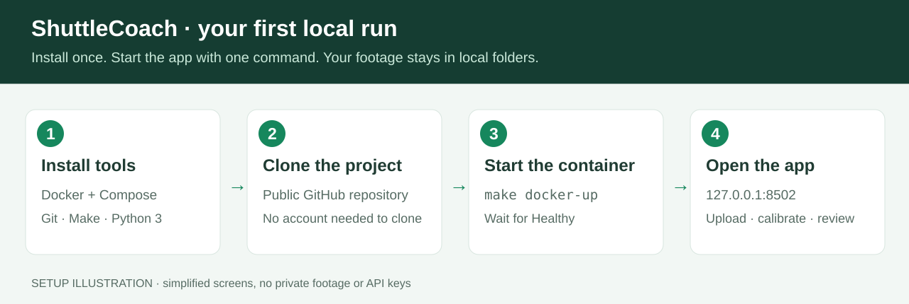

# ShuttleCoach AI

Local badminton video review: manual court calibration, player/birdie tracking,
video-assisted footwork review, and evidence-linked AI analysis. Measurements,
estimated movement and coaching evidence remain separate.

**New here? Follow the [illustrated installation guide](docs/INSTALL.md)** for
prerequisites, pictures, copyable commands, first-video setup and troubleshooting.



## Start with Docker

Install and start Docker Desktop (or Docker Engine with Compose on Linux), then:

```sh
git clone https://github.com/kagamirudo/shuttlecoach-ai.git
cd shuttlecoach-ai
make docker-up
```

Open **http://127.0.0.1:8502**. The first build installs the pinned Python
runtime; startup downloads missing model weights and verifies their checksums.
Existing footage, models, results and cache stay in their local folders.
The container runs CPU inference; native Mac MPS remains available separately.

```sh
make docker-status        # service and health
make docker-logs          # follow logs; Ctrl+C exits the log view
make docker-test          # tests inside the image, without API secrets
make docker-down          # stop; keep all media and results
make docker-up DOCKER_PORT=8503
```

`make run` remains the native app at port 8501. Docker uses 8502 by default so
an existing calibration session can stay open.

## Use the app

1. Load a local video from `data/`, upload one, or retrieve an authorized YouTube URL.
2. Mark visible court-line intersections, review projected lines, and choose intervals/player labels.
3. Run tracking and inspect the timestamped overlay; full source playback includes audio.
4. Review identities, foot positions, unused court intersections, birdie candidates and actual rallies.
5. Open **AI analysis** for player cards and measurement/video evidence. Use **AI connection settings** for Groq.

AI analysis describes measured coverage, accepted court positions and their
changes over time. Footwork candidates need video confirmation. Practice cards
require validated tracking and repeated reviewed evidence. Short-gap regression
previews use visibly labelled estimates for at most 0.3 seconds; estimates never
increase validation or become coaching evidence.

## API keys

AI is optional; local tracking/reporting works without it. Groq's current model
is `openai/gpt-oss-120b`, with account-specific [Free plan quotas](https://console.groq.com/docs/rate-limits).
Get a key from [Groq Console](https://console.groq.com/keys).

On Mac, `make docker-up` reuses the key saved by this app in macOS Keychain;
otherwise it can use the host's `GROQ_API_KEY`. The launcher provides it as a
Docker runtime secret, not an image layer or command argument. A key entered
only in the container UI lasts for that browser session. No videos, names or
local paths are sent to Groq—only anonymized measurement summaries.

## Documentation

| Guide | Contents |
|---|---|
| [Illustrated installation](docs/INSTALL.md) | Step-by-step setup with pictures and first-run checkpoints |
| [Docker operations](docs/DOCKER.md) | Persistent folders, credentials, ports, CPU limits and troubleshooting |
| [App and native usage](docs/USAGE.md) | Calibration, tracking, validation and CLI commands |
| [Reviewed demonstration](docs/DEMONSTRATION.md) | Historical source-specific metrics and limits |
| [Development](docs/DEVELOPMENT.md) | Code map, tests and packaging changes |
| [Agent handoff](docs/HANDOFF.md) | Current recording, evidence, completed work and remaining limits |
| [Project audit](AUDIT.md) | Provenance, failures and validation methodology |
| [Feasibility comparison](docs/FEASIBILITY.md) | Original repository comparison |

## Repository layout

```text
app.py                 Streamlit interface
shuttlecoach/          tracking adapters, validation, footwork, AI reports
scripts/               model downloaders, Docker launcher and review utilities
tests/                 unit and integration checks
docker/                container entrypoint
vendor/                pinned upstream source and licenses
data/ models/ results/ .cache/   local runtime folders (not committed)
```

The upstream BadmintonAI and TrackNetV3 sources retain their licenses and pinned
provenance. Ultralytics/YOLO has separate AGPL terms; model weights are downloaded
rather than committed. See the usage guide's research/license section.
