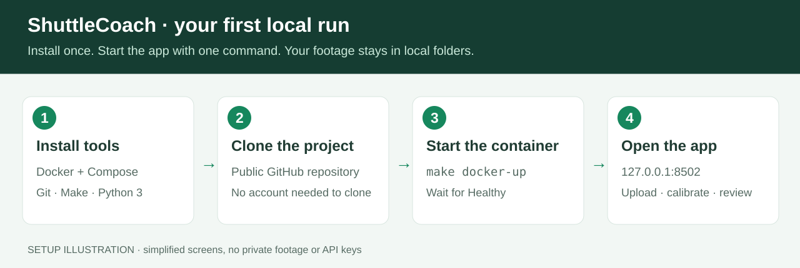
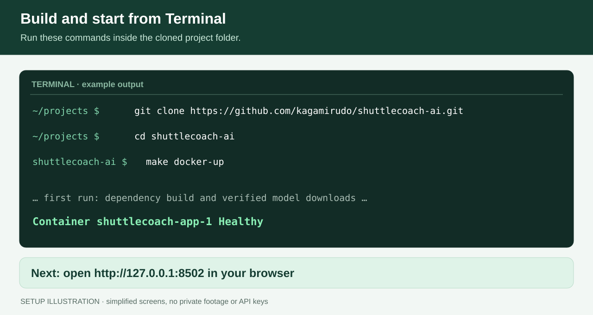
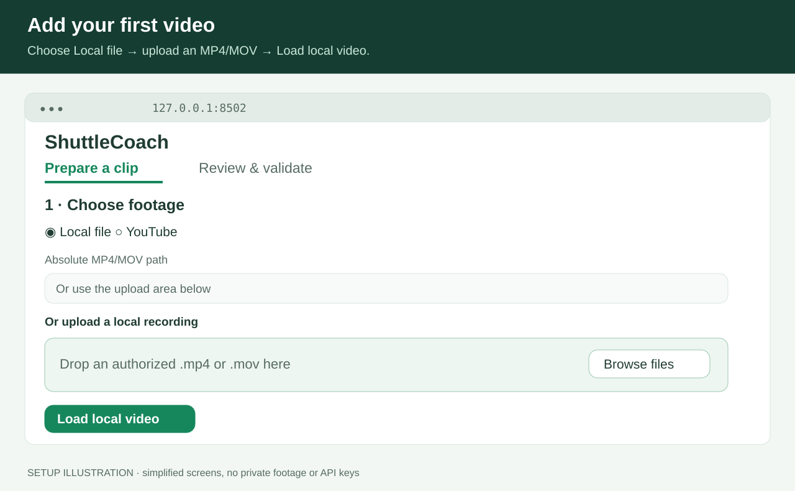
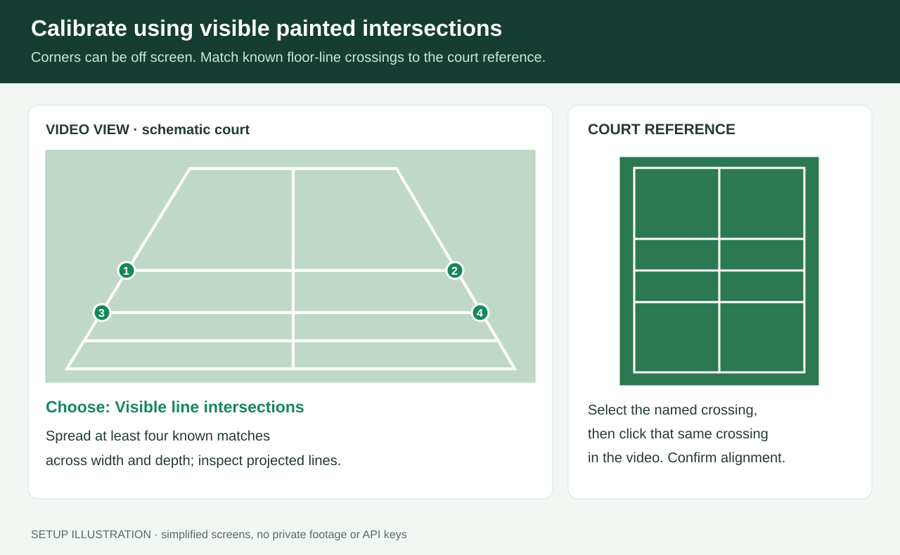
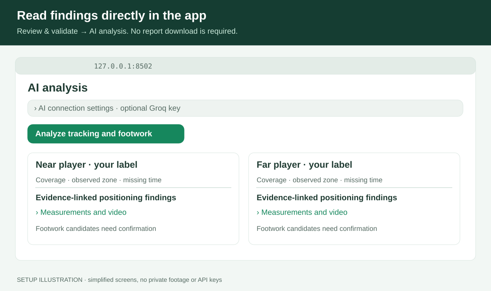

# Install ShuttleCoach AI — illustrated guide

This guide takes you from a fresh checkout to a local dashboard and your first
video review. **No API key is required for installation, calibration or tracking.**
The optional AI report uses Groq after the local app is running.



The pictures are schematic illustrations of the workflow, not screenshots or
sample tracking results. They contain no private footage, identities or keys.

## 1. Choose your setup

| Setup | What to use | Verification status |
|---|---|---|
| Apple silicon Mac | Docker Desktop for Mac + Terminal | Image, startup, model loading/inference and container tests exercised on this setup |
| Intel Mac | Docker Desktop for Intel + Terminal | Instructions provided; Intel image not built in this session |
| Linux | Docker Engine + Compose plugin + a terminal | Linux ARM64 container tested; separate Linux desktop/AMD64 host not exercised |
| Windows | Docker Desktop with WSL 2 + Ubuntu terminal | Suggested route; Windows/WSL not exercised in this session |

The container uses CPU inference. It does not use your Mac's MPS backend.
For native Mac GPU execution, see [native installation](USAGE.md#fresh-installation).
Allow several GB for the image, dependency/build cache and model weights, plus
space for your own videos and tracking outputs. First startup needs internet
access to download dependencies and public model assets.

### Mac: install the prerequisites

1. Open the [official Docker Desktop for Mac installer page](https://docs.docker.com/desktop/setup/install/mac-install/).
2. Choose **Apple silicon** for an M-series Mac, or **Intel chip** for an Intel Mac.
   Check **Apple menu → About This Mac** if you are unsure.
3. Open the downloaded installer, put Docker in **Applications**, and launch it.
   Complete Docker's own setup prompts. Wait until Docker reports that its engine is running.
4. Open **Terminal** from Applications → Utilities or Spotlight.
5. Check the tools below. If Git or Make is missing, run `xcode-select --install`
   and complete Apple's Command Line Tools installer. If Python is missing,
   install Python 3 from the [official macOS downloads page](https://www.python.org/downloads/macos/).
   The host launcher needs Python 3.9 or newer; the app's pinned Python 3.12 runs inside Docker.

```sh
git --version
make --version
python3 --version
docker version
docker compose version
```

**Checkpoint:** every command should work. `docker version` should show both
client and server information. A “cannot connect to the Docker daemon” message
means Docker is not ready yet; start Docker Desktop before continuing.

### Linux: install the prerequisites

Use Docker's [official installation guide for your distribution](https://docs.docker.com/engine/install/).
For Ubuntu, follow the [Docker Engine + Compose plugin instructions](https://docs.docker.com/engine/install/ubuntu/).
Then install the small host tools:

```sh
sudo apt update
sudo apt install git make python3
```

Make sure your normal user can run `docker version` and `docker compose version`.
Use Docker's documented access setup or a rootless daemon; do not run this
project's entire workflow with `sudo` to work around permissions.

### Windows: use the Ubuntu WSL terminal

Follow [Microsoft's WSL installation guide](https://learn.microsoft.com/en-us/windows/wsl/install)
and [Docker's WSL 2 setup guide](https://docs.docker.com/desktop/features/wsl/).
Enable Docker Desktop integration for the Ubuntu distribution you use. Install
`git`, `make` and `python3` inside Ubuntu, using the Linux commands above. Run all
remaining project commands **inside Ubuntu**, not PowerShell or Command Prompt.
Clone under your Linux home directory, such as `~/projects`, rather than treating
this as a native Windows-path installation.

## 2. Download the public project

In Terminal (or the Linux/Ubuntu terminal):

```sh
mkdir -p ~/projects
cd ~/projects
git clone https://github.com/kagamirudo/shuttlecoach-ai.git
cd shuttlecoach-ai
```

You do not need a GitHub account to clone the public repository. If you already
cloned this project, use that existing folder instead of creating a second copy.
All subsequent `make` commands run **from this repository folder**.

You should see `Dockerfile`, `compose.yaml`, `Makefile`, `app.py` and `docs/`.
The repository includes source code and documentation, not videos, downloaded
weights, private results or API credentials.

## 3. Build and start the app

```sh
make docker-up
```



The first run will:

1. Build the Python 3.12 CPU image and install pinned dependencies.
2. Create persistent local folders: `data/`, `models/`, `results/` and `.cache/`.
3. Download missing pose and TrackNet weights, then verify their checksums.
4. Start the dashboard and wait for its health check.

This can take several minutes on a fresh machine. Later starts reuse dependency
layers and downloaded weights. Progress speed depends on your network and CPU;
there is no fixed startup or tracking-time guarantee.

Check status:

```sh
make docker-status
```

**Checkpoint:** the `app` service should be running and healthy. The default host
port is **8502**. A typical final startup line contains `shuttlecoach-app-1` and
`Healthy`; formatting can vary by Docker version.

If startup fails, inspect the log:

```sh
make docker-logs
```

Press **Ctrl+C** to leave the log view; that does not stop the app.

## 4. Open the dashboard

Open **http://127.0.0.1:8502** in your browser.

You should see **ShuttleCoach**, **Prepare a clip**, and **Review & validate**.
On a fresh installation there are no existing analyzed clips. That is expected:
the reviewed examples described in [DEMONSTRATION.md](DEMONSTRATION.md) are not
bundled with the public repository.

If port 8502 is already in use, choose another port:

```sh
make docker-up DOCKER_PORT=8503
```

Then open **http://127.0.0.1:8503**. Use the same `DOCKER_PORT=8503` value for future
`docker-up` commands if you want to keep that address. Native `make run` uses 8501
and can remain separate; the Docker launcher does not kill it.

## 5. Load your first video



In **Prepare a clip**:

1. Select **Local file**.
2. Use **Or upload a local recording** to choose an MP4/MOV you are authorized to analyze.
3. Click **Load local video**.
4. Confirm that the source video plays before configuring tracking.

For large files, you can instead copy a recording into this checkout's `data/`
folder and enter its **absolute path** in **Absolute MP4/MOV path**. The Docker
launcher preserves this checkout's absolute path inside the container, so an
example path on Mac is `/Users/your-name/projects/shuttlecoach-ai/data/match.mp4`.
That example is a placeholder: replace it with your real path. Files elsewhere
on your computer are not automatically mounted; the uploader or `data/` folder
is the simplest route.

The **YouTube** option can retrieve a video you are authorized to download.
Playlist parameters are not an instruction to download an entire playlist.
If a site blocks retrieval, use an authorized local recording; the app does not
bypass access controls.

## 6. Select players, time and court calibration

Under **2 · Mark the rallies**, enter the time intervals and near/far player
labels. Names are your labels, not automatic identity recognition. Each run
supports a span of up to ten minutes. Start with a short segment while checking
calibration, then increase the interval. Exclude warm-up and pauses when you
intend to interpret rally behavior.

Confirm **Exactly two singles players are visible** and **The selected camera
view stays fixed without cuts** only when those statements are true for the
selection. This prototype is intended for fixed-camera singles footage.



Under **3 · Calibrate the court**:

- **Four outer corners:** use only when all four physical doubles-court corners
  are visible. Click near-left, near-right, far-right, then far-left.
- **Visible line intersections:** use for a cropped court or off-screen corners.
  Choose a named painted-line crossing in the court reference, then click the
  matching crossing in the video. Mark at least four distinct points spanning
  court width and depth; more well-spread points are preferable.

Use **floor-line intersections**, not the elevated net cord or arbitrary image
edges. Inspect the projected court lines. Confirm **I reviewed the projected
court lines** only once they align with the actual court. Preview alignment is
not independent calibration validation; unused-line checks come later.

Choose **auto** or **cpu** for Docker, then click **Run player tracking**. Tracking
runs in a worker process. Wait for completion and open the resulting analysis.
A longer CPU selection can be much slower than native Mac MPS; changing Docker
packaging does not make it a real-time system.

## 7. Review results and optional AI analysis



In **Review & validate**:

1. Select your analysis. Watch the analyzed overlay and use **Full source video**
   for the complete original recording/audio.
2. Read per-player coverage, accepted court-zone shares and missing seconds.
   Coverage is availability, not proof of correct identity or accurate feet.
3. Review the frozen validation sample and unused court-line intersections.
   Birdie validation is separate. Failed and occluded frames remain in evaluation.
4. Use **Footwork · movement review** to confirm candidate events and mark timing
   when the video supports it. Candidate counts are not confirmed steps or technique grades.
5. For the optional LLM, open **AI connection settings**, enter a Groq key from
   [Groq Console](https://console.groq.com/keys), then click **Analyze tracking and footwork**.

The report is displayed **directly in the app**. You do not need to download a
Markdown file. Each finding links to its local measurements and a video moment.
The API sees anonymized summaries, not your video, labels, local paths or key as
report evidence. Groq's account-specific [free-plan quotas](https://console.groq.com/docs/rate-limits)
apply; the app does not automatically upgrade billing or retry quota failures.

### Keeping the API key across restarts

- **Already saved on this Mac:** `make docker-up` can reuse this app's existing
  macOS Keychain credential and pass it as a Docker runtime secret.
- **Host environment:** provide `GROQ_API_KEY` through your usual secret manager
  before starting Docker. It is mounted as a runtime secret, not baked into the image.
- **Entered only in the container UI:** it lasts for that browser session.
  Linux containers cannot write to macOS Keychain. To save on Mac, use the native
  app's **Save API key on this Mac**, then restart Docker to import it.

Never paste a key into a GitHub issue, chat, committed file or Dockerfile. Local
tracking and deterministic reports remain usable without any LLM account.

Descriptive AI findings can discuss accepted measurements even when validation
is incomplete. Personalized practice recommendations require the separate
tracking/rally/footwork evidence checks. The AI does not watch or independently
verify the video and does not provide physical biomechanics grades.

## 8. Stop, restart, update and check

Finish active tracking before stopping; interrupted workers do not resume
automatically. Your local media, downloaded weights, results and cache persist.

```sh
make docker-down                 # stop the app, preserve data
make docker-up                   # start again
```

To update the installed source, stop after active jobs finish, then:

```sh
make docker-down
git pull --ff-only
make docker-up
```

Optional verification:

```sh
make docker-test                 # unit/integration tests in the image, no API secrets
```

For native Mac MPS installation and CLI commands, see [USAGE.md](USAGE.md).
For persistence, secret delivery, path compatibility and operational details,
see [DOCKER.md](DOCKER.md).

## Troubleshooting checklist

| What you see | What to check |
|---|---|
| `make: command not found` or missing Git | Install Command Line Tools on Mac, or `git make` in Linux/Ubuntu. |
| `python3: command not found` | Install host Python 3; do not install the entire application venv just for Docker. |
| Docker client exists but server is unavailable | Open Docker Desktop/Engine and wait for it to be ready. |
| `docker compose` is unavailable | Install/update the Compose plugin or Docker Desktop using official instructions. |
| `no makefile found` | `cd` into the cloned `shuttlecoach-ai` directory. |
| Port 8502 is occupied | Start with `DOCKER_PORT=8503`, then open port 8503. |
| Startup health check fails | Read `make docker-logs`; model download/checksum or dependency errors must be resolved. |
| `Permission denied` in mounted data | Use the Make launcher from your normal user so host UID/GID are matched. |
| A source video cannot be found | Use the uploader or this checkout's `data/`; preserve old absolute paths when reusing a run. |
| AI generation is unavailable | Configure an API key; tracking itself does not require one. |
| AI draft is stale | Re-run analysis after tracking/review inputs change; the old cache is not current evidence. |
| No personalized practice appears | Inspect the quality and review requirements; a new LLM cannot repair missing evidence. |

Do not delete `data/` or `results/` to troubleshoot startup. They contain your
footage/configuration and saved work. [Open a GitHub issue](https://github.com/kagamirudo/shuttlecoach-ai/issues)
with the failing command and redacted error text if needed—never attach a key or
private recording.
